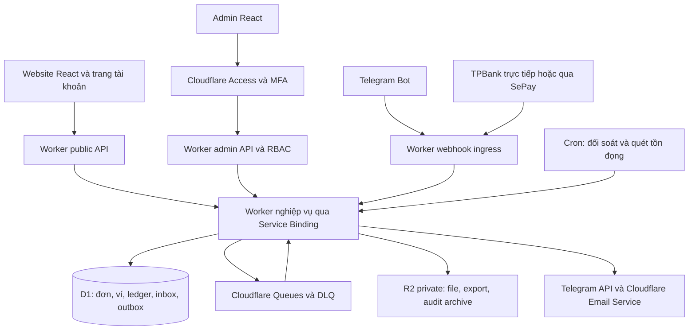

# Kế hoạch nền tảng Tiệm Digital: tài khoản, số dư, TPBank, admin và Telegram

Ngày: 28/10/2026 — cập nhật theo yêu cầu hiệu chỉnh: Telegram và website dùng chung tài khoản, số dư VND và QR TPBank; không dùng Stars. Đã có mã nguồn triển khai, chưa deploy production.

## 1. Phạm vi và quyết định kiến trúc

Yêu cầu đã xác nhận: TPBank nhận tiền; admin quản lý cả website và thanh toán; có bot mua hàng Telegram; tài khoản khách hàng, số dư, thanh toán bằng số dư hoặc QR; hạ tầng ứng dụng trên Cloudflare.

Đề xuất:

- Website: đăng ký/đăng nhập, quản lý hồ sơ, nạp số dư bằng QR TPBank, mua bằng số dư hoặc QR trực tiếp theo đơn.
- Telegram: quản lý đơn, nạp tiền và mua hàng bằng QR TPBank hoặc số dư VND của cùng tài khoản website. Không tạo ví riêng và không thanh toán Stars.
- Backend dùng chung: tài khoản, giá VND, đơn hàng, thanh toán, sổ cái, giao hàng và audit. Cả hai kênh gọi cùng service thanh toán và dùng cùng số dư.
- Cloudflare Workers + Static Assets, D1, Queues, Cron, R2, Access, Turnstile, Secrets và Email Service. Không cần VPS cho phương án TPBank qua nhà cung cấp phù hợp.
- Bắt đầu một cửa hàng, một tài khoản TPBank hoạt động và tiền VND. Không xây multi-tenant, ví chuyển tiền ngang hàng hoặc rút tiền tự động trong bản đầu.

**Quyết định đã hiệu chỉnh:** người dùng yêu cầu QR TPBank và số dư chung cho cả web/bot. Tài liệu Telegram yêu cầu Stars cho hàng số trong bot; đây là rủi ro vận hành nền tảng cần theo dõi, không phải luồng thanh toán được chọn trong sản phẩm. [Telegram policy](https://core.telegram.org/bots/payments-stars)

## 2. Hiện trạng đã kiểm tra từ mã nguồn

| Thành phần hiện tại | Khoảng trống cần xử lý |
|---|---|
| `package.json`: React, TypeScript, Vite; có build/lint | Chưa có backend, Workers config hoặc hạ tầng trong các file đã kiểm tra |
| `src/components/CheckoutModal.tsx:40`: mã đơn tạo bằng ngày và Math.random | Chuyển sang mã do server tạo, có UNIQUE và retry collision |
| `src/components/CheckoutModal.tsx:51`: tổng tiền tính từ giỏ hàng client | Backend lấy giá đáng tin cậy và tự tính lại |
| `src/components/CheckoutModal.tsx:78`: tạo đơn local, gọi callback sau timeout | Callback hiện là tạo đơn, không phải bằng chứng đã nhận tiền |
| `src/services/api.ts:117`: tài khoản nhận tiền MB hardcode | Thay bằng cấu hình TPBank có phiên bản và phê duyệt |
| `src/services/api.ts:128`: URL ảnh VietQR | QR chỉ hướng dẫn chuyển tiền; chưa có xác nhận giao dịch |
| `src/services/api.ts:241`: đơn lưu localStorage | D1 là nguồn đơn hàng chính; không import đơn local như đơn đã thanh toán |
| `src/components/OrderTrackerModal.tsx:7`: tra cứu đơn local | Tra cứu server theo chủ sở hữu, không chỉ biết mã đơn là đọc được |
| `src/services/api.ts:175`: danh mục từ GumTool, có fallback client | Backend cần nguồn giá và tồn kho đáng tin cậy; fallback chỉ phục vụ xem |

Các đường dẫn backend/schema bên dưới đều là đề xuất mới. Chưa xác nhận GumTool có API giữ hàng hoặc giao key; không giả định catalog API làm được các việc này.

## 3. Sơ đồ hạ tầng

- `shop.<domain>`: website, customer API cùng origin; `admin.<domain>`: admin và admin API cùng origin, được Access bảo vệ toàn hostname.
- `hooks.<domain>`: chỉ webhook ngân hàng/Telegram, không login tương tác, không Turnstile/challenge trình duyệt. Dùng xác thực riêng cho từng provider.
- Worker core có D1 binding và thực hiện nghiệp vụ tiền; ingress không được tự ghi số dư. Service Binding giúp tránh public endpoint nội bộ.
- Tắt `workers.dev`/preview public đối với core và các đường vòng admin; kiểm tra cả custom domain, route và preview URL.
- D1 là nguồn chuẩn cho tiền và đơn. Không dùng KV/cache làm nguồn số dư, khóa giao dịch hoặc bằng chứng thanh toán.
- Static Assets giữ frontend hiện có, không cần chuyển framework chỉ để deploy. [Workers Static Assets](https://developers.cloudflare.com/workers/static-assets/)

## 4. Kết nối TPBank

### 4.1 Hai phương án

| Phương án | Điều kiện | Quyết định |
|---|---|---|
| TPBank API trực tiếp | Có hợp đồng/quyền API nhận báo có, tra cứu giao dịch, sandbox và đặc tả bảo mật | Ưu tiên khi TPBank cấp đủ API và PoC Cloudflare thành công |
| TPBank qua SePay API Banking | Liên kết TPBank qua luồng chính thức, webhook có xác thực, API đối soát | Phương án triển khai thực dụng nếu chưa có hợp đồng API trực tiếp |

TPBank có portal API, nhưng trang QR công khai liệt kê các API mockup; không được suy diễn đó là production callback xác nhận tiền. Cần lấy tài liệu đúng sản phẩm thu hộ/biến động số dư được cấp. [TPBank API catalog](https://developer.tpb.vn/tpb/portal/vi/product), [TPBank QRCode](https://developer.tpb.vn/tpb/portal/vi/product/84)

SePay có hướng dẫn TPBank API cho cá nhân/doanh nghiệp và cơ chế TKP qua nội dung chuyển khoản. Không giả định phương án này cấp số tài khoản VA riêng cho từng đơn. Luồng cấp quyền phải ở trang ngân hàng/nhà cung cấp chính thức; website Tiệm Digital không thu thập mật khẩu Internet Banking hoặc OTP ngân hàng. [Liên kết TPBank](https://docs.sepay.vn/ket-noi-tpbank.html)

### 4.2 Gate trước khi kết nối thật

1. Xác nhận tài khoản TPBank cá nhân/doanh nghiệp, tên chủ tài khoản, quyền sử dụng và hình thức kết nối.
2. Có sandbox hoặc quy trình kiểm thử có kiểm soát; biết ID giao dịch ổn định, timestamp/timezone, API phân trang đối soát, retry và refund.
3. Xác nhận HMAC/chữ ký, cấp và xoay key, mTLS, IP allowlist, hạn mức/rate limit, SLA; không đoán contract TPBank từ SePay.
4. Nếu ngân hàng cần static egress: xác nhận gói Cloudflare, topology và PoC thực tế. Workers VPC đang beta; không giả định mặc định có IP cố định hoặc egress binding tự kết hợp mTLS binding. [Workers VPC](https://developers.cloudflare.com/workers-vpc/configuration/vpc-networks/)
5. Nếu dùng outbound mTLS, kiểm tra hostname đích và chứng thư thực tế; Cloudflare nêu giới hạn với đích đang được Cloudflare proxy. [Workers mTLS](https://developers.cloudflare.com/workers/runtime-apis/bindings/mtls/)

QR sinh từ snapshot ngân hàng, số tiền và mã thanh toán do server tạo. Mã payment intent không tái sử dụng; dùng alphabet/độ dài tương thích provider và UNIQUE. Hết hạn trên app không ngăn một QR chuyển khoản thông thường tiếp tục nhận tiền.

## 5. Tài khoản và số dư

### 5.1 Trang khách hàng

- Đăng ký, xác minh email, đăng nhập/đăng xuất, phục hồi tài khoản, quản lý phiên; bổ sung passkey/MFA cho thao tác nhạy cảm.
- Hồ sơ, danh sách đơn, chi tiết trạng thái thanh toán/giao hàng, lịch sử nạp/trừ/hoàn tiền, số dư khả dụng.
- Nạp tiền: chọn số tiền trong hạn mức → tạo top-up intent → QR TPBank → chờ ngân hàng xác nhận → cộng số dư.
- Checkout: chọn số dư hoặc QR thanh toán đúng đơn. Bản đầu không kết hợp một phần ví + một phần QR để giảm trường hợp giữ tiền và hết hạn phức tạp.
- QR trực tiếp vào đơn không đồng thời cộng ví; top-up cộng ví không tự thanh toán đơn. Hai mục đích có intent riêng và không chuyển mục đích chỉ dựa vào số tiền.

Auth khách hàng dùng thư viện đã được duy trì, PoC tương thích Workers/D1 và cơ chế hash/session trước khi chốt phiên bản; không tự viết thuật toán password/token. Admin dùng Access riêng, không dùng chung phiên khách hàng. Email Service cần xác nhận quyền dùng, DNS/SPF/DKIM và thử gửi email giao dịch trên domain. [Cloudflare Email Service](https://developers.cloudflare.com/email-service/get-started/send-emails/)

### 5.2 Sổ cái và tính đúng đắn

Quy ước bản đầu: số dư là khoản trả trước dùng mua hàng tại Tiệm Digital; không có chuyển tiền giữa người dùng hoặc rút tự động. Chính sách hạn mức, hoàn tiền và điều kiện cung cấp dịch vụ phải được duyệt trước khi nhận nạp thật.

- Mọi số tiền mới đều là VND, lưu integer theo đơn vị đồng; không dùng float. Trường tiền tệ cũ chỉ phục vụ đọc lịch sử, không dùng để tạo thanh toán mới.
- Ledger hai vế bất biến: mỗi journal cùng currency phải cân bằng; tài khoản liability của khách và tài khoản clearing ngân hàng/doanh thu được phân biệt. Quy tắc ghi nhận kế toán cần kế toán duyệt.
- `wallet_accounts.available_balance` là projection có kiểm soát, cập nhật cùng transaction với ledger; có kiểm tra tái tính và cảnh báo lệch. UI không có API ghi đè số dư.
- Trừ ví: claim thanh toán đơn chưa trả → trừ có điều kiện `available_balance >= amount` → ghi journal → chuyển PAID → ghi outbox trong một atomic operation. Không đọc số dư rồi ghi lại bằng hai request riêng.
- D1 batch atomic khi có lỗi SQL; UPDATE 0 dòng không tự rollback. Phải thiết kế guard/constraint để toàn batch không thể commit một phần nghiệp vụ khi thiếu tiền hoặc mất claim. Viết thử nghiệm race trước khi chốt SQL. [D1 batch](https://developers.cloudflare.com/d1/worker-api/d1-database/)
- Chống xử lý lặp bằng UNIQUE trên operation ID, provider transaction ID, allocation của giao dịch và payment settlement của đơn. Một giao dịch không thể vừa top-up vừa trả đơn; đơn không thể bị trừ ví hai lần.
- Refund/điều chỉnh bằng journal bù có liên kết bản gốc, lý do, người thực hiện, phê duyệt và audit; không sửa/xóa ledger cũ. Hoàn tiền ngân hàng chưa thành công thì không ghi là đã hoàn.
- Chạy đối chiếu tổng liability và tổng ledger/projection; freeze thao tác tiền khi phát hiện lệch chưa giải thích được.

## 6. Luồng thanh toán và giao hàng

### 6.1 Website thanh toán QR

1. Khách đã đăng nhập gửi SKU, số lượng, mã ưu đãi và idempotency key. Backend bỏ qua giá/discount do client gửi.
2. Backend xác thực nguồn giá/tồn kho, tính lại tổng tiền, lưu snapshot giá/ưu đãi và tạo order + payment intent có hạn.
3. Trả QR và thông tin TPBank của intent; khách chuyển tiền. UI polling có backoff, dừng khi hoàn tất/ẩn tab; trạng thái tiền đọc nhất quán từ D1 primary khi cần. [D1 read consistency](https://developers.cloudflare.com/d1/best-practices/read-replication/)
4. Webhook được xác thực trên raw body, giới hạn payload, kiểm tra timestamp/replay theo contract provider. Sau đó lưu inbox bền vững rồi ACK đúng định dạng provider.
5. Worker đối chiếu giao dịch tiền vào, đúng tài khoản nhận, currency, số tiền và mã intent chính xác; mã mơ hồ không auto-match.
6. Atomic batch ghi bank transaction/allocation + settlement PAID hoặc ledger top-up + outbox. Dùng cùng một pipeline khi dữ liệu đến từ webhook hoặc cron đối soát.
7. Queue xử lý giao hàng/thông báo có idempotency; UI chỉ báo đã thanh toán khi backend đã commit PAID.

Với SePay HMAC, kiểm tra đúng định dạng timestamp/raw body và cửa sổ replay theo tài liệu; IP allowlist chỉ là lớp bổ sung. Không áp dụng thời gian cửa sổ của SePay cho TPBank trực tiếp khi chưa có đặc tả. [SePay webhook authentication](https://developer.sepay.vn/vi/sepay-webhooks/xac-thuc)

### 6.2 Trạng thái và ngoại lệ

- Payment intent: `PENDING → SUCCEEDED | EXPIRED | CANCELED`; giao dịch đến muộn vẫn được ghi nhận và đưa vào review, không bỏ tiền thật vì intent đã hết hạn.
- Order payment: `UNPAID → PAID → REFUND_PENDING → PARTIALLY_REFUNDED | REFUNDED`; xử lý trạng thái refund theo bản ghi refund riêng.
- Fulfillment riêng: `NOT_READY → QUEUED → PROCESSING → DELIVERED | FAILED`. Lỗi giao hàng không đảo PAID thành UNPAID.
- Thiếu/thừa tiền, sai mã, không có mã, hai giao dịch cùng intent: lưu và REVIEW; bản đầu không tự chia tiền, cộng tiền thừa hoặc tự hoàn ngân hàng.
- Race ví và QR: chỉ một settlement thắng. Nếu tiền ngân hàng vẫn đến sau khi ví đã trả, ghi khoản nhận dư để review/hoàn đúng quy trình, không giao thêm lần nữa.
- Đơn tổng tiền bằng 0 xử lý theo chính sách ưu đãi riêng, không tạo QR 0 đồng.
- Ngân hàng/provider gián đoạn: hiển thị chờ xác minh; không tin ảnh biên lai hoặc nút “đã chuyển tiền”.

### 6.3 Độ bền và giao hàng số

D1 và Queue không có transaction chung. Inbox/outbox phải lưu trước, có Cron quét tồn đọng để enqueue lại; Queue chỉ mang ID, hạn chế PII. Consumer có retry, backoff và DLQ; duplicate/out-of-order không làm lùi trạng thái. [Queues delivery guarantees](https://developers.cloudflare.com/queues/reference/delivery-guarantees/), [Queues retries](https://developers.cloudflare.com/queues/configuration/batching-retries/)

Nếu kho key nội bộ: giữ chỗ/cấp key bằng transaction, UNIQUE key allocation theo order item, mã hóa giá trị key và chỉ chủ đơn được nhận. Nếu supplier ngoài có idempotency key thì dùng; nếu timeout mà chưa rõ kết quả thì tra cứu trước retry. Không hứa giao hàng “exactly once” khi supplier không có cơ chế đó. Bản đầu cho phép giao thủ công có audit nếu GumTool chỉ cung cấp catalog.

## 7. Bot Telegram và tài khoản thanh toán chung

- Menu: `/start`, `/products`, `/balance`, `/topup`, `/orders`, `/support` và `/paysupport`.
- Liên kết Telegram ID với user đã đăng nhập website qua token một lần, TTL ngắn, hash trong D1 và xác nhận lại tại website. Không ghép qua username/email tự khai.
- Danh mục và giá VND giống web. Tạo order channel=telegram nhưng cùng owner, tiền tệ VND và state machine.
- Khách chọn trả bằng số dư hoặc QR TPBank. Nạp qua `/topup <amount>` tạo TOPUP intent và cộng đúng ví chung khi ngân hàng xác nhận.
- Bot gọi cùng createOrder/payWallet/createIntent/intentFor với API web; website trả được đơn bot và bot trả được đơn web của chính owner.
- Chỉ webhook TPBank/đối soát hoặc atomic wallet debit mới xác nhận PAID. Nút kiểm tra trạng thái không phải bằng chứng trả tiền. Không có luồng invoice/Stars.
- Webhook bot có secret, dedupe update_id, giới hạn private chat và rate limit theo cùng user ID. Callback phải kiểm ownership, account lock và liên kết hiện hành.
- Tiền xử lý cùng ledger, idempotency, trigger và outbox. Retry webhook/bấm lại/race web-bot không trừ thêm số dư hoặc settle hai lần.
- Bot chỉ gửi thông báo và liên kết nhận hàng sau xác thực; không công khai key/PII trong group hoặc lịch sử chat.

## 8. Admin cấu hình website, thanh toán và vận hành

Khung giao diện: sidebar trái; khu vực chính danh sách/chi tiết; trạng thái môi trường TEST/PROD luôn hiển thị. Thay đổi nhạy cảm có màn hình diff, lý do và trạng thái chờ duyệt.

| Màn hình | Chức năng |
|---|---|
| Tổng quan | Doanh số VND theo kênh web/Telegram, số dư liability, đơn chưa trả, giao hàng lỗi, đối soát chậm |
| Khách hàng | Hồ sơ, khóa tài khoản, thu hồi phiên, liên kết Telegram, lịch sử đơn/sổ cái; hạn chế xem PII |
| Số dư và ledger | Nạp/trừ/hoàn, journal gốc/bù, đối chiếu, yêu cầu điều chỉnh; không chỉnh trực tiếp balance |
| Đơn hàng | Kênh web/Telegram, payment/fulfillment riêng, timeline, giao thủ công và retry có audit |
| Giao dịch TPBank | Inbox, giao dịch unmatched, review thiếu/thừa, đối soát lại theo khoảng ngày |
| Thanh toán | TPBank account/BIN/holder, provider, trạng thái kết nối, TTL intent, hạn mức top-up, bảo trì |
| Sản phẩm/kho | Nguồn catalog, giá VND dùng chung, tồn kho/giữ hàng, phương thức giao key, voucher |
| Pages | Danh sách slug, SEO, hero/banner, FAQ, liên hệ, footer, điều khoản và hướng dẫn |
| Biên tập page | Block được whitelist, draft → preview → publish → rollback; không nhúng HTML/JS tùy ý |
| Media | Upload ảnh có giới hạn kích thước/type, kiểm tra nội dung, tách R2 public media khỏi bucket private |
| Telegram | Bot identity, secret status, menu/template, webhook health, lỗi gửi và cấu hình QR/số dư chung |
| Bảo mật/audit | Phân quyền, phiên admin, diff cấu hình, log điều chỉnh ví, phê duyệt, cảnh báo |

Phân quyền: Owner, Finance, Support, Content Editor, Auditor. Editor không đổi tài khoản nhận tiền; Support không cộng số dư; Finance tạo yêu cầu điều chỉnh và không tự duyệt yêu cầu của mình.

Thay tài khoản nhận tiền/credential và điều chỉnh số dư phải re-auth/MFA + phê duyệt bởi người thứ hai. Nếu chỉ có một owner, quy trình ngoại lệ phải được thiết kế rõ trước production, không tự bỏ kiểm soát trong code.

Secrets hiển thị metadata/masked status; bản đầu rotation qua Cloudflare Secrets bằng operator có quyền, admin chỉ kiểm tra trạng thái. Không cấp quyền quản trị Cloudflare toàn account cho Worker để tiện sửa secret. Intent cũ giữ snapshot tài khoản/provider/key version cần thiết cho xác minh; không đổi đích nhận tiền của QR đã phát hành.

## 9. Mô hình dữ liệu và API đề xuất

Nhóm bảng:

- Identity: users, sessions, verification tokens, admin role bindings, telegram_links và link challenges.
- Commerce: products/catalog snapshots, prices theo currency, promotions, orders, order_items, inventory allocations, fulfillment attempts.
- Payment: payment_intents (`purpose=ORDER|TOPUP`, owner, currency, amount, account/config snapshot), provider_transactions, payment_allocations, settlements, refunds.
- Wallet: wallet_accounts, ledger_journals, ledger_entries, adjustment_requests/approvals. Ràng buộc đơn vị tiền, balance không âm và journal cân bằng phải được kiểm chứng ở tầng DB/nghiệp vụ.
- Operations: webhook_inbox, outbox_events, telegram_updates, reconciliation_runs/cursors, exception_cases, audit_events.
- CMS: pages, page_versions, media_assets, settings_versions, config_approvals.

API (đề xuất, chưa tồn tại):

| Nhóm | Endpoints |
|---|---|
| Auth/hồ sơ | `/api/auth/*`, `GET/PATCH /api/me`, `GET/DELETE /api/me/sessions/*` |
| Public | `GET /api/catalog`, `GET /api/pages/:slug` — chỉ dữ liệu published |
| Đơn | `POST /api/orders`, `GET /api/me/orders`, `GET /api/orders/:id` |
| Thanh toán | `POST /api/orders/:id/payments/qr`, `POST /api/orders/:id/payments/wallet` |
| Ví | `GET /api/me/wallet`, `GET /api/me/wallet/transactions`, `POST /api/me/topups` |
| Liên kết Telegram | `POST /api/me/telegram-link`, `POST /api/me/telegram-link/confirm`, `DELETE /api/me/telegram-link` |
| Webhook | `POST /webhooks/bank/:provider`, `POST /webhooks/telegram` |
| Admin | `/api/admin/pages/*`, `/settings/*`, `/orders/*`, `/wallet-adjustments/*`, `/reconciliation/*`, `/audit/*` |

Mọi read/write nhạy cảm kiểm tra ownership/RBAC ở server. Tất cả command tài chính có idempotency key và request-body hash: cùng key khác nội dung trả conflict. Phân trang keyset cho ledger/giao dịch; index theo account, owner, status, provider transaction ID và thời gian.

## 10. Kiểm soát bảo mật

- Access + IdP MFA cho admin; Worker verify JWT signature/issuer/audience/expiry, sau đó check vai trò trong ứng dụng. Header email đơn thuần không đủ. [Access JWT validation](https://developers.cloudflare.com/cloudflare-one/access-controls/applications/http-apps/authorization-cookie/validating-json/)
- Customer session cookie Secure/HttpOnly, ưu tiên host-only, SameSite phù hợp; kiểm tra Origin/CSRF cho mutation. Logout/recovery/khóa tài khoản thu hồi session; không lưu token đăng nhập trong localStorage.
- Turnstile cho đăng ký/khôi phục/tạo intent theo rủi ro; bắt buộc Siteverify và kiểm hostname/action. Kết hợp rate limit theo IP, account, device/session và hạn mức tiền. [Turnstile validation](https://developers.cloudflare.com/turnstile/get-started/server-side-validation/)
- Schema validation, prepared SQL, allowlist provider hostname/callback, timeout outbound; cấu hình CMS không được biến thành SSRF bằng URL tùy ý.
- CSP theo origin thực tế, HSTS sau kiểm tra domain, chặn framing và MIME sniffing. API tiền/hồ sơ trả `Cache-Control: no-store`, không bị cache như page public.
- Credentials và bot token chỉ trong Workers Secrets; tách dev/staging/prod, rotation có key version. Không đưa API key vào Vite `VITE_*`, bundle hoặc repo. [Workers Secrets](https://developers.cloudflare.com/workers/configuration/secrets/)
- Key sản phẩm và payload nhạy cảm mã hóa bằng cơ chế authenticated encryption; key nằm ngoài D1. Log redaction, R2 private, quyền truy cập tối thiểu, export có audit/expiry. Không dùng SSE-at-rest như lý do cho phép mọi nhân viên đọc secret.
- Audit ứng dụng append-only gồm actor, action, target, before/after đã lọc, lý do, request ID. Export sang vùng lưu trữ tách quyền theo chính sách; không gọi D1 audit là bất biến tuyệt đối trước quyền chủ account.
- CI token tối thiểu quyền, dependency/secret scan, review riêng money/auth code. WAF/rate-limit/Access entitlement phải được kiểm tra theo gói mua, không giả định mọi tính năng có trên Free.

## 11. Đối soát, quan sát và phục hồi

- Cron đề xuất 5–15 phút tùy API quota: lấy giao dịch phân trang với cửa sổ chồng lấn, dedupe, lưu cursor chỉ sau khi persist hết dữ liệu. Có đối soát cuối ngày giữa ngân hàng, settlement, wallet ledger và fulfillment.
- SePay có API giao dịch để bù webhook bị mất; dùng tài liệu đúng sản phẩm/API version thay vì trộn Bank Hub events với webhook tiền vào. [SePay reconciliation](https://developer.sepay.vn/vi/sepay-webhooks/doi-soat-giao-dich)
- Theo dõi: signature failures, tuổi inbox/outbox, DLQ depth, unmatched money, last successful reconciliation, chênh ledger/balance, duplicate settlements, tồn kho bị giữ lâu, Telegram failures.
- Ngưỡng/SLO là mục tiêu cần đo staging: ACK webhook nhanh sau persist; backlog bình thường dưới 1 phút; đối soát chậm quá 2 chu kỳ thì cảnh báo. Không cam kết thời gian tiền vào vượt SLA ngân hàng.
- D1 Time Travel 7 ngày Free/30 ngày Paid theo tài liệu hiện tại; thêm export mã hóa dài hạn vào R2 nếu cần. [D1 backups](https://developers.cloudflare.com/d1/reference/time-travel/)
- Runbook: lộ key, đổi tài khoản nhận, ngân hàng down, ledger lệch, restore D1, xử lý giao dịch muộn, supplier timeout, Telegram down. Sau restore phải đối soát lại và tránh replay giao key/credit đã xảy ra bên ngoài; backup không tự bảo đảm điều này.
- Không chạy nhiệm vụ tiền quan trọng chỉ trong `waitUntil` mà không có inbox/outbox bền vững.

## 12. Kế hoạch triển khai

| Giai đoạn | Công việc | Tiêu chí hoàn thành |
|---|---|---|
| 0. Chốt contract và PoC | TPBank direct/SePay, account type, auth runtime, Email Service, Telegram webhook sandbox, catalog/fulfillment contract | Chứng minh nhận và đối soát được giao dịch, chốt luồng bank và Telegram |
| 1. Nền tảng Cloudflare | Worker boundaries, D1 schema, bindings, môi trường, Access/MFA, logs, CI | Không có đường vòng admin; staging tách production |
| 2. Tài khoản và commerce | Auth, hồ sơ, giá server, order ownership, idempotency, catalog | Sửa giá client không ảnh hưởng tổng tiền server |
| 3. QR và đối soát | Intent order/top-up, webhook inbox, atomic settlement, Queue/outbox, Cron, review | Webhook lặp/mất/đảo thứ tự không ghi tiền sai |
| 4. Ví | Ledger, top-up credit, wallet debit, refund, approvals, customer wallet UI | Race không âm ví, không double credit/debit, sổ cái cân |
| 5. Admin/CMS | Pages, media, preview/publish/rollback, finance, TPBank config, RBAC/audit | Editor không tác động tiền; thay config có version/phê duyệt |
| 6. Telegram | Link account, menu/cart, QR/số dư, payment status, hỗ trợ, notifications | Bot/web dùng chung tiền; callback hoặc webhook lặp không trừ số dư hai lần |
| 7. Pilot production | Security tests, restore drill, giao dịch TPBank nhỏ có kiểm soát, runbooks, monitoring | Toàn bộ nghiệm thu bên dưới đạt trước mở nạp tiền rộng |

Ước lượng lập kế hoạch: khoảng 5–8 tuần cho một developer có kinh nghiệm, chưa gồm thời gian duyệt hợp đồng/API ngân hàng hoặc chờ quyền nền tảng. Cần ước lượng lại sau PoC và quyết định giao key tự động hay thủ công.

File dự kiến: giữ frontend `src/`; thêm `workers/` cho ingress/core/admin, `wrangler.jsonc`, schema D1 và cấu hình test/CI. Hình thức thay đổi schema phải theo quy ước dự án/tool triển khai được chọn khi bắt đầu implementation.

## 13. Nghiệm thu bắt buộc và điểm cần chốt

Các kịch bản kiểm thử:

1. Hai yêu cầu trừ ví đồng thời, tổng vượt số dư: chỉ yêu cầu đủ tiền được settle; balance không âm; journal không lệch.
2. Top-up webhook gửi lặp 100 lần, từ webhook lẫn cron: đúng một credit.
3. QR order intent không thể bị đổi thành top-up để vừa nhận hàng vừa cộng ví.
4. Ví và QR cùng trả một đơn: một settlement; tiền vào dư được review; giao hàng một lần.
5. Sai chữ ký/timestamp/tài khoản/số tiền/currency/mã: không PAID, không cộng ví.
6. Tiền đến sau hết hạn, nội dung rỗng hoặc có nhiều mã: lưu tiền và review, không làm mất bằng chứng.
7. Crash sau D1 commit trước enqueue, Queue duplicate/out-of-order, consumer restart: sweeper phục hồi, không double money operation.
8. Khách A không đọc đơn/ví/key của B bằng sửa ID; user Telegram khác không dùng callback/link token của A.
9. Trừ ví thành công nhưng response timeout: retry cùng key nhận kết quả cũ; cùng key khác body bị từ chối.
10. CMS XSS, CSRF, admin bypass qua preview URL, đổi TPBank không đủ role/phê duyệt: bị chặn.
11. Bot/web cùng trả một đơn chỉ có một settlement; tài khoản khác hoặc bot đã hủy liên kết không được thanh toán/đọc đơn.
12. Restore D1 rồi reconcile không cộng lại tiền/giao lại key đã thực hiện; giao dịch ngoại hệ còn đủ bằng chứng để phục hồi.
13. `npm run build` và `npm run lint` hiện có phải pass khi implementation thay frontend; bổ sung integration tests trên D1/Workers runtime cho tiền/auth và kiểm thử E2E staging.

Cần chốt khi triển khai, không ngăn việc review plan này:

- TPBank cá nhân hay doanh nghiệp; đã có API contract trực tiếp hay dùng SePay API Banking?
- Hạn mức nạp/số dư, chính sách hoàn, khoản nạp đến muộn và người duyệt điều chỉnh tiền.
- Bot username, webhook secret và người vận hành hỗ trợ/tranh chấp thanh toán ngân hàng.
- Domain, gói Cloudflare, Email Service entitlement, số admin và IdP MFA.
- Nguồn giá/tồn kho chuẩn, API giao sản phẩm hoặc quy trình thủ công; chính sách bảo vệ key/tài khoản bán.

Không tự động deploy, liên kết ngân hàng, tạo bot, gửi tin khách hoặc nhận tiền thật trong bước lập kế hoạch này.
